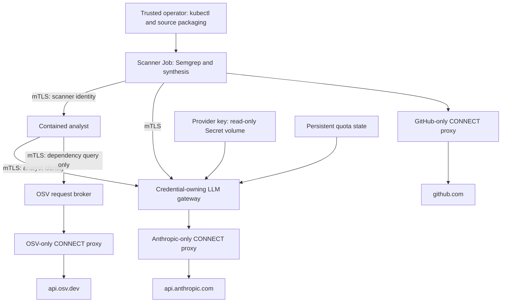

# Hostile Code Scanner

**Release status:** the local team profile below is a candidate upgrade. Unit and
local TLS integration checks pass; the new scanner image and live cluster upgrade
still require validation. Multipass recovery is currently blocking those checks.
The existing lab deployment has not been upgraded to this profile.

A private scanner for untrusted source code: Semgrep, deterministic prompt-injection
checks, a contained LLM analyst with dependency lookups, and evidence-preserving
report synthesis. The local team profile keeps provider credentials outside the
scanner and analyst, and authenticates internal services with mutual TLS.

The supported deployment is a trusted operator's single-node k3s cluster in the
Multipass `lab` VM. This is a bounded local tool, not a public multi-tenant service
or a high-availability deployment. Production use must fit the limits below and
the operational responsibilities in [OPERATIONS.md](OPERATIONS.md).

## Run a scan

On the configured Ubuntu VM:

```bash
cd /home/ubuntu/lab/codescan
export KUBECONFIG=/home/ubuntu/.kube/config
./run-scan.sh dast/target
./run-scan.sh https://github.com/OWNER/REPO.git
```

The host packages source and orchestrates Kubernetes. Source parsing, Semgrep,
agent calls and synthesis run in a disposable scanner Job. Full scans send source
to Anthropic and incur provider usage. Repositories are read, never executed or
installed. Git submodules and package installation scripts are not run.

Successful reports are retained under `reports/codescan-<id>.json` on the operator
host with mode `0600`; the directory is created with mode `0700`. Failed scans
retain bounded private logs. Temporary Jobs and uploaded source ConfigMaps are
removed afterward. `reports/` is excluded from Git and Docker build contexts.
Reports can contain sensitive findings: share them only with authorized reviewers.

## Boundaries



- **Provider credential isolation:** only the gateway mounts the Anthropic key.
  Scanner and analyst use distinct client certificates, with no provider key in
  their environments or volumes. Gateway clients reject an accidental provider key.
- **Authentication:** TLS 1.2+ verifies server and client certificates. Workload
  identity comes from the verified certificate URI, never an HTTP header. Only
  scanner identity may call the analyst. Only analyst identity may call OSV.
- **Outbound request policy:** the LLM gateway permits only the configured Haiku
  model, bounded non-streaming Messages requests, and the analyst's `check_cve`
  tool. It supplies authentication itself and never forwards caller credentials.
  Provider URLs and API paths are fixed; redirects are not followed.
- **OSV body inspection:** a dedicated HTTPS broker validates the dependency
  request before forwarding it. It permits only a bounded PyPI package/exact-version
  query, rejects extra fields, duplicate keys, encoded bodies, unexpected headers
  and known secret markers, and replaces outbound metadata. The current runtime
  does not use mitmproxy or install an interception CA. The earlier MITM lab
  demonstration is kept, undeployed, in `legacy/mitm_waf/`.
- **Network policy:** workloads have no direct internet or Kubernetes API route;
  only DNS and their declared service/proxy paths are permitted. The scanner waits
  for direct-deny connectivity checks before reading source. This is a check of
  specific paths, not proof against every possible exfiltration channel.
- **Container controls:** non-root users, read-only root filesystems, dropped
  capabilities, RuntimeDefault seccomp, no Kubernetes API tokens or host mounts,
  bounded scratch space, CPU/memory limits and a scanner deadline.
- **Analyst process controls:** `k8s/kill-shell.yaml` uses Tetragon to kill shell
  spawning in analyst pods. Semgrep and Git may spawn trusted scanner processes.
  Tetragon must be installed and verified separately; its manifests are not a
  substitute for a working enforcement implementation.

The node, Kubernetes control plane, operator accounts, gateway and broker are
trusted. Containers share the node kernel. A compromised model/analyst may still
manipulate analysis or attempt allowed operations; containment limits capability,
not semantic correctness. An authorized query value can still encode information.
The source intentionally sent to Anthropic is not filtered for secret-like strings.

## Resource and usage limits

| Limit | Default |
|---|---:|
| Active analyst requests | 1 |
| Gateway in-flight provider requests | 4 |
| Gateway requests per identity per UTC minute | 30 |
| Gateway requests per identity per UTC day | 200 |
| Model output tokens per request | 2,048 |
| Gateway / analyst encoded request body | 256 KiB |
| Analyst source context | 80,000 characters |
| Dependency manifest / injection warning | 16,000 characters each |
| Local source plus optional DAST report | 700 KiB compressed |
| Local source expanded size / file count | 128 MiB / 10,000 files |
| Scanner runtime | 15 minutes |
| Native Semgrep input file | 1 MiB |

Quota reservations are atomic and persist in SQLite on a PVC; restarting the
process or Pod does not reset them. Failed upstream calls also consume a reservation.
These are request limits, not a dollar budget. Configure provider spending controls
separately. Model retries are disabled to avoid hidden duplicate usage.

Oversized analyst contexts fail explicitly rather than silently truncating code.
Split larger targets into supported directories. Larger local uploads can use an
HTTPS GitHub URL, but the same analysis context limit still applies. Private Git
credentials, other Git hosts, AST chunking and a shared job queue are not configured.
A busy analyst returns an explicit error; this profile does not promise concurrent
scan scheduling. Symlinks, generated directories, `.env` files and credential
folders are excluded from local uploads; other hardcoded secrets may still be read
and sent to the configured provider.

## Evidence and incomplete scans

Semgrep and analyst failures fail the scan. Invalid model JSON or malformed findings
cannot become an empty "clean" result. Raw findings of every severity are recovered
if synthesis drops or downgrades them. Synthesis confidence is derived from the
actual input tool identities referenced by validated evidence indices; the model
cannot invent a second scanner name to claim corroboration. Final severity ordering
is deterministic. Cross-tool grouping still needs human review.

The runner validates exactly one escaped JSON report record and strips terminal
control characters from human output. Missing, duplicate or oversized reports fail.
Report text is data and is not rendered as HTML or executed.

## Build and install the local team profile

Prerequisites: Docker access, a working k3s context with NetworkPolicy enforcement,
the `scanner` namespace with restricted PodSecurity admission, and the existing
`anthropic` Secret with key `api-key`. Provision that Secret through your trusted
operator workflow; do not put its value in Git or chat.

Run in the VM from the project root:

```bash
export KUBECONFIG=/home/ubuntu/.kube/config
python3 tools/build_local_release.py
bash tools/enable_team.sh
```

The release builder installs runtime graphs from SHA-256-hashed lock files, builds
from a pinned Python base, audits the runtime dependency graphs, imports the images
into k3s, and pins manifests to the imported image content digests. A failed build
or audit stops before Kubernetes image import or deployment. It does not create
cloud resources. Dependency auditing does not cover all operating-system or runtime
vulnerabilities; base image maintenance and platform review remain operator duties.

The scanner image uses the native Semgrep engine and a build-validated rule
snapshot. The Python Semgrep CLI and its telemetry dependency graph stay in the
build stage. Engine errors fail the scan. Validate relevant language coverage
before promoting this candidate; the runtime adapter is not a replacement for
application-specific detection tests.

`enable_team.sh` provisions identities, starts the gateway and OSV broker, recreates
the standalone analyst Pod to change its volumes, then verifies live isolation.
The upgrade briefly interrupts analyst availability. The existing Anthropic Secret
is mounted directly into the gateway; the setup tool does not extract its value.

The root signing key is held in an immutable Kubernetes Secret used only by the
trusted issuer command. Workloads receive only their own leaf identity and public
CA. Leaf certificates last 90 days; renew them monthly:

```bash
python3 tools/setup_internal_tls.py --rotate
python3 tools/verify_scanner.py
kubectl exec -i -n scanner cve-agent -- python - < tests/team_cluster_probe.py
```

New TLS handshakes reload server certificate files. New analysis clients reload
client identities. Allow Kubernetes volume projection time after renewal. An
expired or mismatched identity fails closed; there is no plaintext fallback. Root
CA replacement is a separate planned migration, not automatic renewal.

## Verification and development

Use Python 3.12+ in an isolated development environment:

```bash
python3.13 -m venv .venv
source .venv/bin/activate
pip install -r requirements-dev.txt
python -m unittest discover -s tests -v
python tools/verify_team_local.py
```

The TLS integration test uses a synthetic provider key and a local stub, including
negative identity tests and restart-persistent quotas. It does not call the model.
Legacy MITM tests are skipped unless their optional dependency is installed.

Live checks on the VM, also without paid model calls:

```bash
python3 tools/verify_scanner.py
kubectl exec -i -n scanner cve-agent -- python - < tests/team_cluster_probe.py
```

The broker probe queries a public dependency and checks blocked payloads. A full
sample scan (`./run-scan.sh dast/target`) additionally validates real model access
and uses provider credits. The GitHub verification workflow runs tests, stubbed TLS
integration, dependency audits and image builds with read-only repository permissions
and pinned action commits. It has no production or model credentials.

## Detection results and DAST

Historical small benchmark results: Semgrep precision 1.00, recall 0.67, F1 0.80;
LLM analyst precision 0.86, recall 1.00, F1 0.92. These are demonstration results,
not a production-scale coverage or accuracy guarantee. Evaluate relevant target
languages and applications before relying on findings.

Optional ZAP scanning remains scoped to an explicitly supplied, controlled deployed
target. It executes trusted tooling in a separate namespace and folds parsed stdout
alerts into the same report. It is not part of the validated local team profile;
untrusted application execution needs a separate VM-level isolation design.

## Code map

Each box in the diagram above is one workload. Kubernetes names are historical
(`cve-agent`, `egress-proxy`); the code uses "analyst" and "OSV broker".

| Workload (k8s name) | Image (`docker/Dockerfile.*`) | Code |
|---|---|---|
| Operator host | none | `run-scan.sh` → `scan-job.sh` → `tools/scan_job.py`, `tools/reports.py` |
| Scanner Job (`codescan-*`) | `scanner` | `codescan/entrypoint.py` → `pipeline.py` → `codescan/` stages |
| Analyst (`cve-agent`) | `agent` | `service/analyst.py` → `codescan/analyst_agent.py` |
| LLM gateway (`llm-gateway`) | `gateway` | `service/gateway.py`, `gateway_policy.py`, `quota.py` |
| OSV broker (`egress-proxy`) | `proxy` | `service/osv_broker.py`, `osv_policy.py` |
| CONNECT proxies (`scanner-proxy`, `llm-egress-proxy`, `osv-egress-proxy`) | `gateway` (`command:` override) | `egress/proxy.py` with a per-deployment host allowlist |
| Identity issuer (operator-run) | `identity` | `tools/provision_identity.py` via `tools/setup_internal_tls.py` |

Scan data flow inside the scanner Job (`pipeline.scan`):
`workspace` copy → `semgrep_scan` + `injection` → `analyst_client` (mTLS to the
analyst) → optional `zap_report` → `synthesize` (LLM merge, then deterministic
authority backstop).

Other directories:

- `k8s/`: manifests, network policy and the persistent quota volume.
- `dependencies/`, `requirements*.txt`: per-image hash-locked runtime graphs.
- `tools/`: release build, certificate renewal, live verification, report retention.
- `tests/`: unit and adversarial tests; `*_probe.py` run inside live Pods.
- `benchmark/`, `dast/target/`, `samples/`: labeled examples (with the benchmark-only
  `baseline_analyst.py`) and deliberately vulnerable demonstration apps.
- `legacy/mitm_waf/`: undeployed MITM inspection demo, kept for reference.
